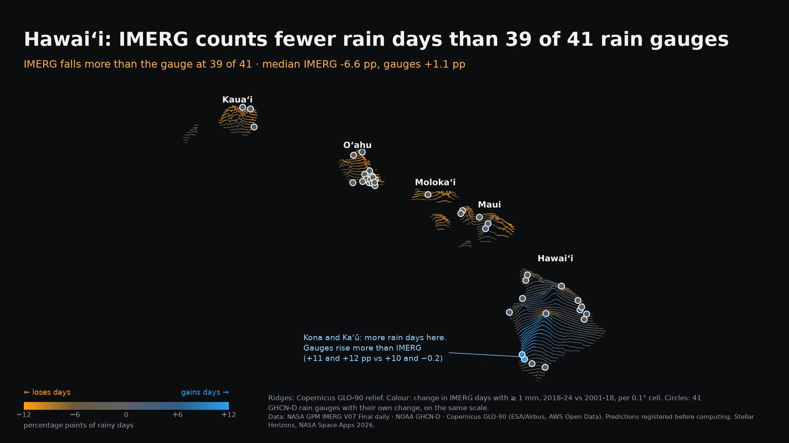
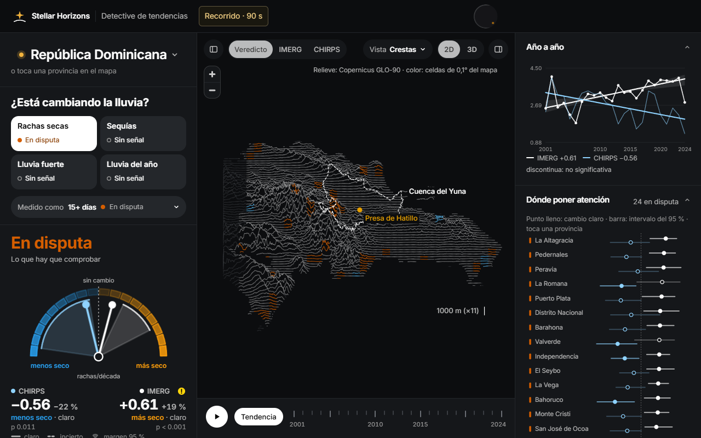
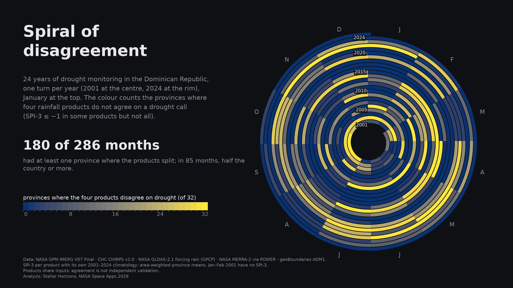

# Stellar Horizons · Earth System Trend Detective

**NASA Space Apps Challenge 2026 · "Be An Earth System Trend Detective!" · Dominican Republic**

**Live tool: [earth-system-detective.vercel.app](https://earth-system-detective.vercel.app/?lang=en)** (English) · [Español](https://earth-system-detective.vercel.app/?lang=es)

> **Before you trust a rain trend, ask who measured it.**


---

## 1. The problem

Imagine you have to prepare Villa Riva, in the lower Yuna basin, for the next rainy season. The Yuna has flooded
**14 times between 2001 and 2024**. You ask three scientific sources whether it rains more or less than before.

**One says less. One says the same. The third says more.**

That happens today, in the same territory:

| Share of days with ≥ 1 mm, after vs before Feb 2018 (15 cells covering the country) | Change |
|---|---|
| NASA IMERG (satellite, the most used product) | **−5.1 percentage points** (falls in all 15 cells) |
| CHIRPS (satellite + gauges) | +0.04 |
| NASA MERRA-2 (reanalysis) | **+8.6** (with its own break in 2015) |

And the ground truth is thin. The country has only **4 public rain gauges in GHCN-D, all at coastal airports**, and
none in the mountains where the rivers start. So municipalities, students and researchers take the satellite trend
at face value. If the instrument changed, the trend lies, and people prepare for the wrong future.

**The problem is not a lack of data. It is trusting data nobody has cross-examined.**

## 2. What nobody had checked

We cross-examined NASA's IMERG, the product behind thousands of rain studies. Since 2018, 2,853 published works
mention it; 206 compute trends, 204 drought and 383 rain frequency (OpenAlex).

- **IMERG is losing rain days, above all drizzle.** In the Dominican Republic the drop grows as the rain gets lighter:
  −7.2 pp at 0.1 mm, −4.8 at 1 mm, −2.0 at 5 mm. CHIRPS does not show it.
- **It is not a Dominican quirk.** Against every long-record rain gauge, IMERG counts fewer rain days than **18 of 19
  gauges in Puerto Rico and 39 of 41 in Hawaiʻi**: 57 of 60, in two oceans, under two different geostationary
  satellites. The gauges barely change (+0.6 and +1.1 pp); IMERG falls (−7.4 and −6.6 pp).
- **It came in two steps.** The big one coincides with IMERG's switch from the TRMM era to the GPM era around 2014.
  A second one after 2018 appears in the Caribbean but not in Hawaiʻi, so the GOES-16 satellite alone cannot be the
  cause. The IMERG team itself reports remaining inhomogeneities in V07 and corrects them in V08 (Joyce, Huffman et al.,
  EGU 2026). That is compatible with our finding, not a confirmation of it.

**Why it matters:** if an instrument misses drizzle, every remaining rainy day looks heavier and dry spells look
longer. IMERG's "rain is getting more intense" and "dry spells are getting longer" trends could not be confirmed by
the second source.




## 3. Our solution: Stellar Horizons

**A trend detective that puts every trend on trial before giving a verdict.**

1. **Pick a place and a variable.** 32 provinces, 21 rain and drought indices, 2001-2024, NASA data at the core.
2. **Two sources testify.** The tool computes the trend with IMERG and with CHIRPS, with honest statistics:
   Mann-Kendall with the Hamed-Rao correction, Theil-Sen slope and FDR for many places at once.
3. **Witnesses cross-examine.** Rain gauges, a reanalysis and synthetic counter-examples check whether the instrument
   itself moved.
4. **Verdict.** It says what changed, where, how much and whether it is significant: *robust*, *consistent*,
   *disputed* or *no detectable signal*. If the witnesses do not confirm a trend, it tells you so.



What you can see in it:
- **The country as ridgelines**, with its rivers, Pico Duarte, the four pilot towns and the only four public gauges.
- **The same country seen twice**, once by IMERG and once by CHIRPS, with the provinces where they disagree outlined.
- **Hurricanes with their real forecast lead time**, and **municipal preparation** for the Yuna pilots (Bonao,
  Cotuí, Villa Riva, Monte Cristi).
- **Where to measure next**, and every number downloadable with its source.

## 4. From finding to action: two kinds of rain, two warnings

Floods in the Yuna come from **two different machines**:

- **Hurricanes (6 of 14 floods).** The official NHC forecast, *as it was issued*, put the storm within 200 km
  **106 h before the flood (María), 88 h (Fiona), 40 h (Isaac, Isaías)**. That is time for the cheap actions:
  shelters ready, watching the Hatillo dam level, telling communities. The cost: 33 storms forecast nearby in 24
  years, only 5 of them with a catalogued flood.
- **Non-tropical rain (8 of 14).** No observed-rain signal arrived before the flood started. Here the answer is to
  measure better, not to promise predictions.

When the rain arrives, **asking a second product to confirm** the heavy-rain trigger, with only the information
available at the time, cut false alarms from **39 to 16**, while detecting 6 of 8 test floods instead of 7 (2016-2024;
n = 8, so indicative).


## 5. Why you can trust it

- **Predictions written before computing.** 12 tests, **43 registered predictions: 20 met, 16 not met**, 7 referred to
  the conclusions table. Each has its registration time, result time, script, data, SHA-256 hash and git commit:
  [`TRAZABILIDAD.md`](reports_nacional/TRAZABILIDAD.md).
- **We publish what failed.** Retracted or not supported: a single IMERG step in 2013 "explaining 82 %"; a daily
  test that blamed GOES-16; a flood backtest that looked at the next day; "after hurricanes comes drought" (drought is
  actually *less* frequent in the 90 days after a cyclone, 16 % vs 21 % of days); "the soil remembers"; vegetation
  that "looks green but stays stressed".
- **We say what 24 years cannot show.** Extreme-rain trends are not detectable: a change in Rx5day would have to be
  39 mm per decade to be seen. "Not detectable" is not "no change".
- Every conclusion has a degree of certainty in [`ESTADO_CONCLUSIONES.md`](reports_nacional/ESTADO_CONCLUSIONES.md),
  and the challenge is mapped sentence by sentence to the evidence in
  [`RETO_A_EVIDENCIA.md`](reports_nacional/RETO_A_EVIDENCIA.md).



## 6. Impact

- **Local:** a municipality in the Yuna basin gets a two-level plan, a pre-alert from the hurricane forecast and a
  confirmed alert when two sources agree, plus a map of where a new rain gauge is most needed.
- **Scientific:** anyone using IMERG for rain frequency, dry spells or intensity trends can check them first. Our
  witnesses work for V07 today and can check V08 when it is released.
- **Global:** the method only needs a satellite product and a few independent witnesses, so it works in any country.


## 7. What comes next
1. Run the same witnesses on **IMERG V08**: does the drizzle loss disappear?
2. Bring in **Dominican gauges** (INDRHI, ONAMET, community networks) to test whether real Dominican rain changed.
3. **Pilot with Yuna technicians** (civil defence, municipalities): the two-level warning in a real season.
4. Package the audit so **any country** can run it on its own rain.

## What we do not claim
- That real Dominican rain changed: there are no dense Dominican gauges to check it.
- The exact cause of IMERG's change: we know GOES-16 alone is not enough.
- That we predict floods: for non-hurricane floods, no signal arrived before the flood.

---

## Data (NASA at the core)
- **NASA GPM IMERG V07** Final, daily and half-hourly, via GES DISC OPeNDAP (Earthdata).
- **NASA MERRA-2** (PRECTOTCORR) via NASA POWER; **GLDAS**, **SMAP** L4 soil moisture, **MODIS** vegetation and water.
- CHIRPS v2.0 (UCSB CHC), ERA5 (witness), NOAA GHCN-D rain gauges, NOAA IBTrACS and the NHC ATCF forecast archive,
  Copernicus GLO-90 relief, OpenStreetMap rivers, geoBoundaries.

## Run and reproduce
```bash
cd web
npm install
npm run dev
```

All analysis runs in Docker, and each script registers its predictions before computing:

```bash
docker compose run --rm --entrypoint uv tropical run --frozen --no-sync python -m earthmemory.tropical.puerto_rico
docker compose run --rm --entrypoint uv tropical run --frozen --no-sync python -m earthmemory.tropical.hawaii
docker compose run --rm --entrypoint uv tropical run --frozen --no-sync python -m earthmemory.trazabilidad
```

The Earthdata token is read only from `.secrets/earthdata_token`, which is git-ignored.

## Use of AI
AI-assisted tools were used for software development support, research exploration, documentation, writing, and
review. Scientific results were generated through reproducible computational workflows, with methods, data sources,
limitations, and validation procedures documented by the team. AI-assisted content was reviewed before inclusion. Any
AI-generated visual or audio assets are identified in the relevant materials.

---
Stellar Horizons, Dominican Republic, 2026.
