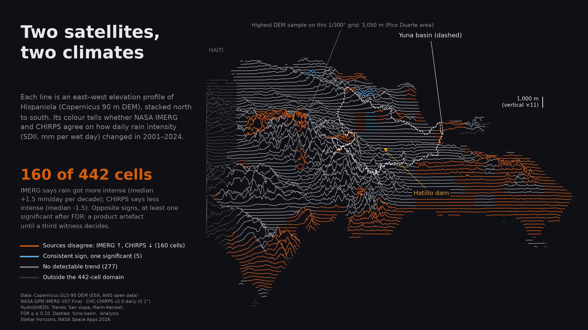
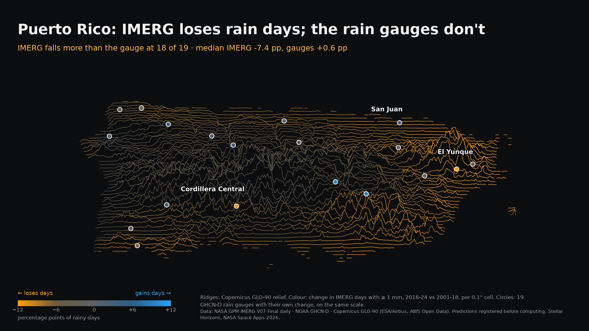
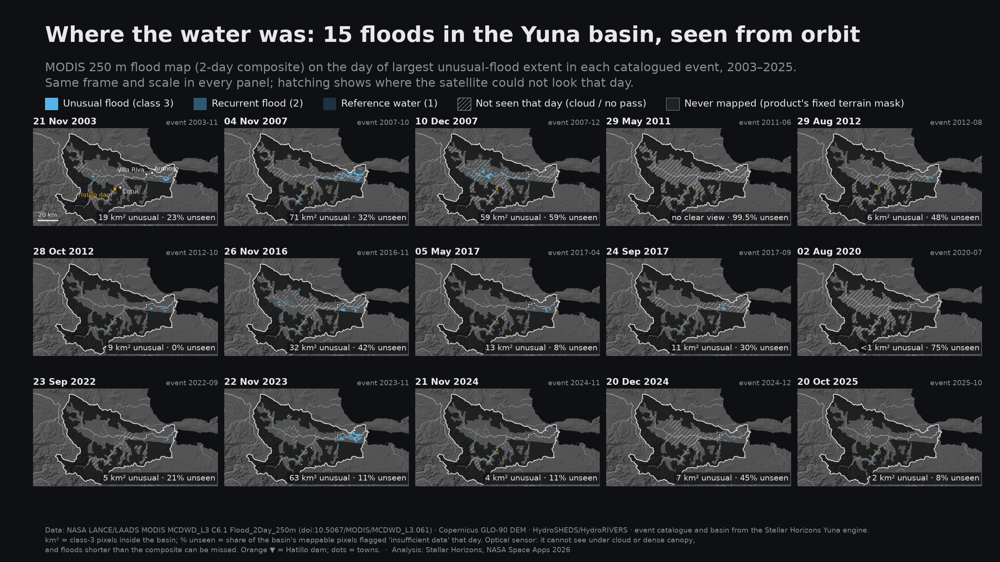
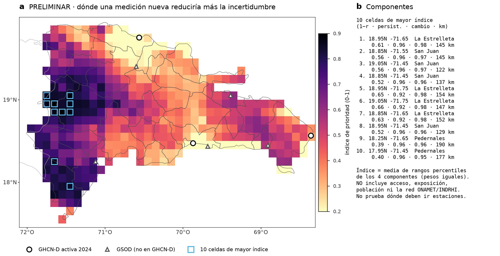

# Stellar Horizons · Earth System Trend Detective

**NASA Space Apps Challenge 2026 · "Be An Earth System Trend Detective!" · Dominican Republic**

> Three scientific sources, one territory, three answers: is it raining less, the same, or more?
> Stellar Horizons does not pick the answer it likes. It checks each trend against independent witnesses first,
> and only then tells you what changed, where, how much, and whether it is significant.



## The answer in one paragraph

In the Dominican Republic, the biggest change in satellite-measured rain is **how NASA's IMERG counts rain days, not
the rain itself**. Against rain gauges that do not change, IMERG loses rainy days, above all light-rain days. We
replicated this outside our country: **IMERG counts fewer rain days than 57 of 60 rain gauges in Puerto Rico and
Hawaiʻi, in two oceans and under two different geostationary satellites.** So any IMERG trend in rain frequency,
dry spells or rain intensity has to be checked before anyone acts on it. Floods in the Yuna basin come from two
different "machines" (hurricanes and non-tropical rain), and each needs a different warning.

## What we found (and the figure behind each finding)

### 1. Same territory, three opposite trends
Share of days with at least 1 mm of rain, after vs before February 2018, over the 15 MERRA-2 cells that cover the
country: **IMERG −5.1 percentage points (falls in all 15 cells), CHIRPS +0.04, MERRA-2 +8.6**. MERRA-2 is discarded as
a witness because it has its own break in November 2015. The challenge says a variable can show one trend in one
place and the opposite in another; here it happens in the *same* place, depending on the instrument.

### 2. The loss is in drizzle
IMERG's drop grows as the rain threshold gets lighter: **−7.2 pp at 0.1 mm, −4.8 at 1 mm, −2.0 at 5 mm** (land cells).
CHIRPS: +1.4, +0.3, −1.4. If an instrument misses drizzle, every remaining rainy day looks heavier and dry spells look
longer. That is exactly why IMERG's "rain is getting more intense" and "dry spells are getting longer" trends could
not be confirmed by the second source.


### 3. It is not a Dominican quirk: Puerto Rico and Hawaiʻi
We registered predictions first, then compared IMERG with every long-record GHCN-D rain gauge.
- **Puerto Rico:** IMERG falls more than the gauge at **18 of 19** gauges (median IMERG −7.4 pp, gauges +0.6 pp).
  IMERG falls in all 89 land cells.
- **Hawaiʻi:** **39 of 41** (median IMERG −6.6 pp, gauges +1.1 pp). In Kona and Kaʻū IMERG rises, but the gauges there
  rise even more, so IMERG still counts fewer rain days.




### 4. When did it happen? Two steps, not one
Hawaiʻi sits under GOES-West, so it separates two suspects that reached the Caribbean 19 days apart (GOES-16 and the
NOAA-20 microwave sounder). The main drop coincides with IMERG's switch from the TRMM era to the GPM era around 2014
(Hawaiʻi −9.6 pp, Puerto Rico −6.2 pp). A second drop after 2018 appears in the Caribbean (Puerto Rico −3.5, Dominican
Republic −4.5 vs CHIRPS) but not in Hawaiʻi. GOES-16 alone cannot be the cause. The IMERG team itself reports
remaining inhomogeneities in V07 inputs and corrects them in V08 (Joyce, Huffman et al., EGU 2026,
doi:10.5194/egusphere-egu26-14694). That is compatible with our finding, not a confirmation of it.

### 5. Floods come from two machines
Of **14 Yuna basin floods (2001-2024), 6 came with a hurricane** within 500 km. For those, the official NHC forecast,
*as it was issued* (ATCF archive), put the storm within 200 km **106 h before the flood (María), 88 h (Fiona), 40 h
(Isaac, Isaías)**. The cost was 33 storms forecast nearby in 24 years, only 5 of them with a catalogued flood. For the
other 8 floods, no observed-rain signal arrived before the flood started. So the answer there is more measuring, not
prediction.



### 6. A warning that asks for a witness
Requiring a second product to confirm IMERG's heavy-rain trigger, using only information available at the time,
cut false alarms from **39 to 16**, while detecting 6 of 8 test floods instead of 7 (2016-2024, n = 8, indicative).

### 7. Where to measure
The country has only **4 public rain gauges in GHCN-D, all at coastal airports** (Puerto Plata, Punta Cana, Barahona,
Santo Domingo), and none in the mountains where the rivers start. The tool marks where a new gauge is most
needed.



## Things we analysed that did NOT hold up (published on purpose)
- **"After hurricanes comes drought"**, or "no hurricanes brings drought": not supported either way. Drought is *less*
  frequent in the 90 days after a cyclone (16 % vs 21 % of days).
- **A single IMERG step in October 2013 explaining 82 % of the contradictions**: retracted after review.
- **A daily test blaming GOES-16**: retracted; the subtraction of counters was not valid.
- **A flood backtest that looked at the next day**: retracted and redone causally.
- **"The soil remembers"** (GLDAS memory) and **PHANTOM** (vegetation looks green but stays stressed): not supported
  with observed data.
- **Extreme rain trends**: not detectable in 24 years. A change in Rx5day would have to be 39 mm/decade to be seen.
  "Not detectable" is not "no change".

## How we know: traceability
Every test wrote its predictions to disk **before** downloading or computing. **12 tests, 43 registered predictions:
20 met, 16 not met, 7 referred to the conclusions table.** The failed ones are published too.
- [`reports_nacional/TRAZABILIDAD.md`](reports_nacional/TRAZABILIDAD.md): each test with its question, data, script,
  registration time, result time, verdict, SHA-256 hashes and git commit.
- [`reports_nacional/ESTADO_CONCLUSIONES.md`](reports_nacional/ESTADO_CONCLUSIONES.md): every conclusion with its
  degree of certainty (confirmed, holds with limits, hint, hypothesis, not supported or retracted).
- [`reports_nacional/RETO_A_EVIDENCIA.md`](reports_nacional/RETO_A_EVIDENCIA.md): the challenge, sentence by sentence,
  mapped to the evidence.

## The tool
Pick a place and a rain index (21 indices, 32 provinces, 2001-2024). The tool shows the trend from IMERG and from
CHIRPS, whether each is significant (Mann-Kendall with Hamed-Rao correction, Theil-Sen slope, FDR), and a verdict:
robust, consistent, disputed, or no detectable signal. Other views cover the country as ridgelines with its rivers,
the same country seen by two sources, hurricanes with their forecast lead time, and municipal preparation for the
Yuna pilots (Bonao, Cotuí, Villa Riva, Monte Cristi). Every number can be downloaded with its source.


```bash
cd web
npm install
npm run dev
```

## Data (NASA at the core)
- **NASA GPM IMERG V07** Final, daily and half-hourly, via GES DISC OPeNDAP (Earthdata).
- **NASA MERRA-2** (PRECTOTCORR) via NASA POWER; **GLDAS**, **SMAP** L4 soil moisture, **MODIS** vegetation and water.
- CHIRPS v2.0 (UCSB CHC), ERA5 (witness), NOAA GHCN-D rain gauges, NOAA IBTrACS and NHC ATCF forecast archive,
  Copernicus GLO-90 relief, OpenStreetMap rivers, geoBoundaries.

## Reproduce
All computation runs in Docker. Each script registers its predictions before it computes. For example:

```bash
docker compose run --rm --entrypoint uv tropical run --frozen --no-sync python -m earthmemory.tropical.puerto_rico
docker compose run --rm --entrypoint uv tropical run --frozen --no-sync python -m earthmemory.tropical.hawaii
docker compose run --rm --entrypoint uv tropical run --frozen --no-sync python -m earthmemory.trazabilidad
```

The Earthdata token is read only from `.secrets/earthdata_token`, which is git-ignored.

## Perspectives: what comes next
1. **Check IMERG V08** with the same witnesses as soon as it is released: does the drizzle loss disappear?
2. **Dominican rain gauges** (INDRHI, ONAMET, community networks) to test whether real Dominican rain changed. That is
   the one thing we cannot say yet.
3. **A pilot with Yuna technicians**: the hurricane pre-alert plus the witness-confirmed alert, two levels for two
   kinds of rain.
4. **Any country**: since 2018, 2,853 published works mention IMERG; 206 compute trends, 204 drought and 383 frequency
   (OpenAlex, title or abstract). These are the measures this artefact touches. It is an upper bound of exposure, not a
   count of wrong studies.

## What we do not claim
- That real Dominican rain changed: there are no dense Dominican gauges to check it.
- The exact cause of IMERG's change: we know GOES-16 alone is not enough.
- That we predict floods: for non-hurricane floods, no signal arrived before the flood.

## Use of AI
We used AI assistants (Anthropic's Claude) to help write code, run the analyses and draft text. Every number in this
repository comes from a script and a result file here, and the predictions were registered before computing.

---
Team guide in Spanish: [`GUIA_EQUIPO.md`](GUIA_EQUIPO.md). Stellar Horizons, Dominican Republic, 2026.
