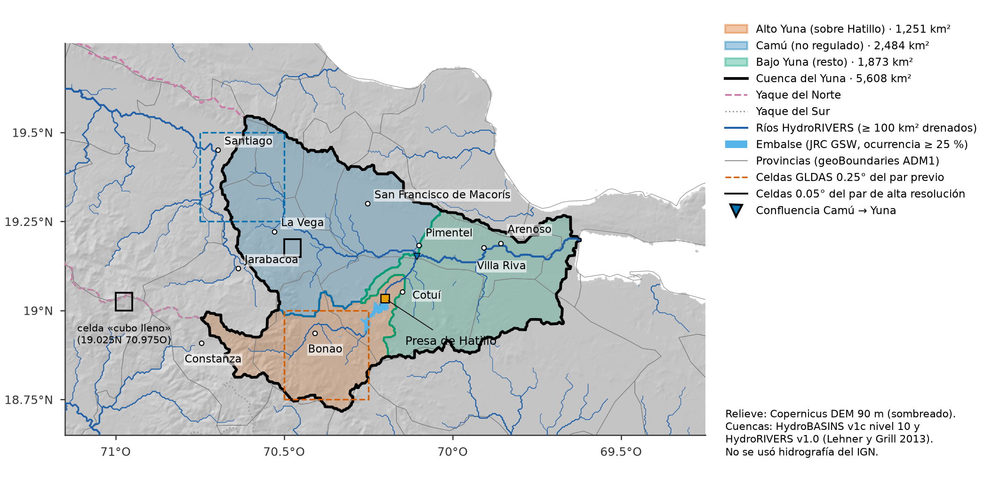
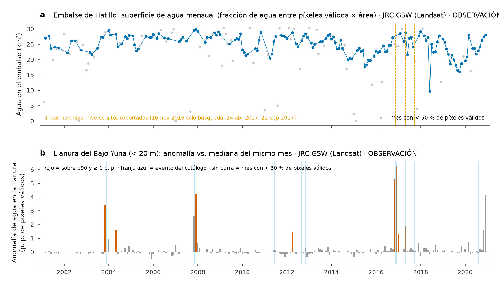
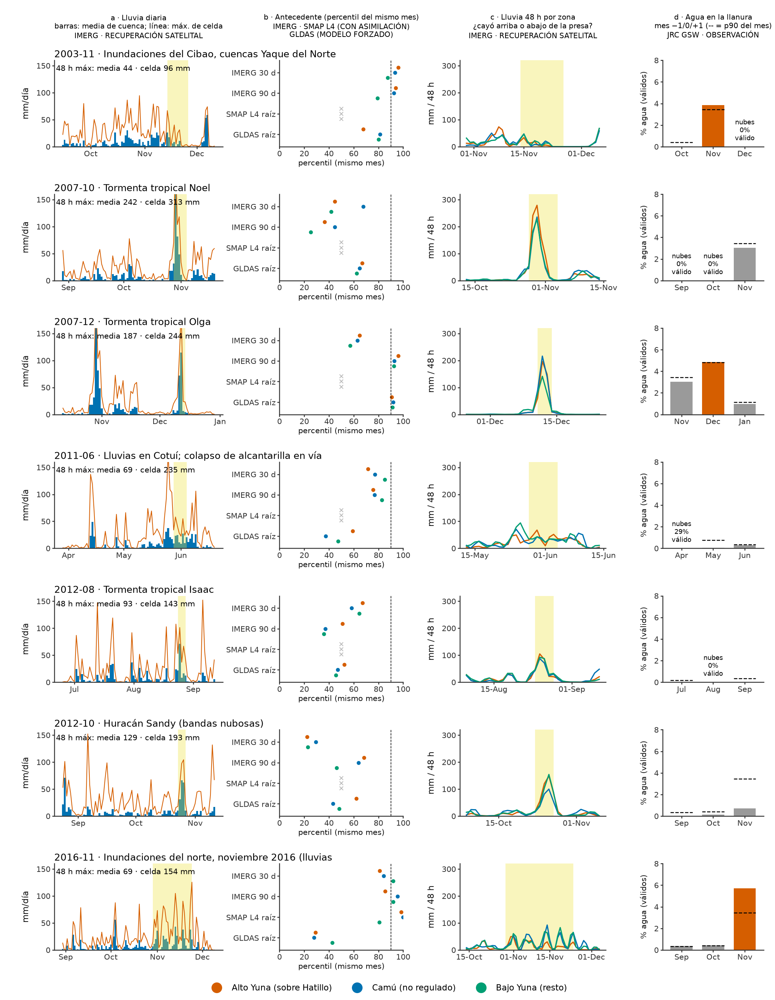
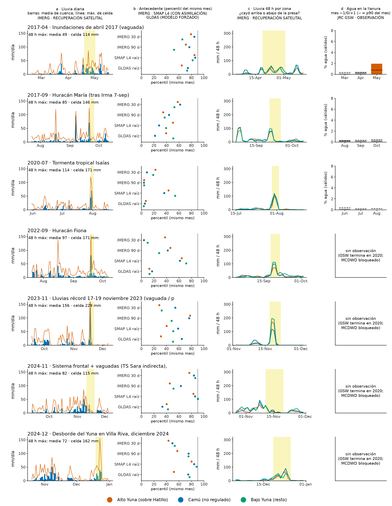
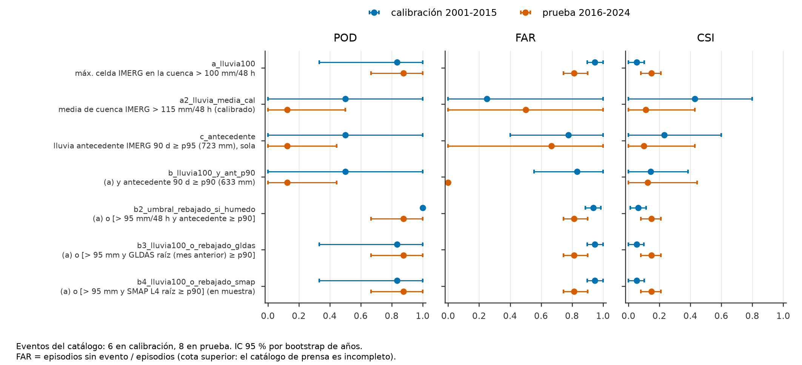
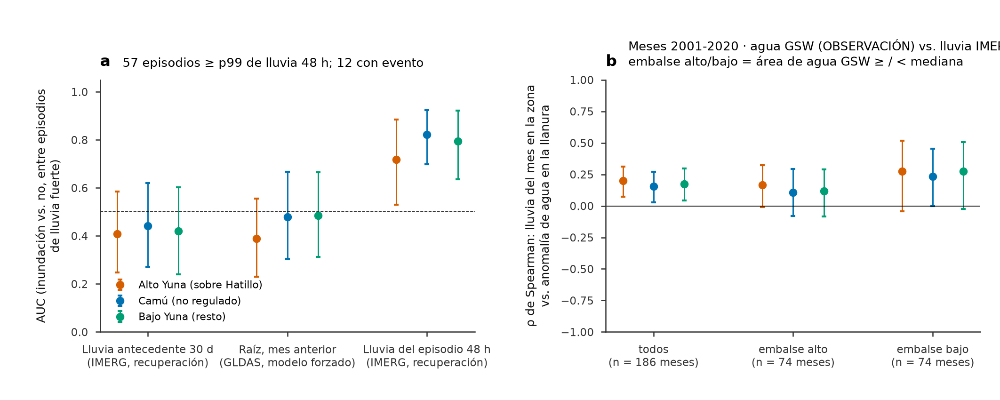

# Caso Yuna · lluvia y memoria arriba → presa de Hatillo → inundación abajo

Stellar Horizons · NASA Space Apps 2026 («Be An Earth System Trend Detective!»). Generado por
`earthmemory/yuna/run.py`; todos los números salen de `results/yuna/`. Fecha de las búsquedas: 2026-11-14.

**Hipótesis de investigación (no causalidad demostrada):** lluvia y estado antecedente del Alto Yuna
(IMERG · SMAP L4 · GLDAS) → escorrentía y respuesta del río (relieve · cobertura · caudal) → presa de Hatillo
(almacenamiento · entradas · salidas) → inundación de arrozales del Bajo Yuna (eventos observados y registrados).
**Giro «Mentalist»:** la operación del embalse podría cambiar la correlación entre la humedad de cabecera y las
inundaciones de abajo. Un resultado así es válido, no un fracaso.

Clases de variables (se repiten en cada figura): **OBSERVACIÓN** (JRC GSW, Landsat) · **RECUPERACIÓN SATELITAL**
(IMERG V07, CHIRPS v2) · **MODELO CON ASIMILACIÓN** (SMAP L4) · **MODELO FORZADO** (GLDAS-2.1 Noah) ·
**SIMULACIÓN HIDROLÓGICA** (GEOGLOWS v2) · **REGISTRO DOCUMENTAL** (catálogo).

## Resumen en cinco líneas

1. La cuenca del Yuna (HydroBASINS nivel 10) mide 5608 km² (UP_AREA en la desembocadura:
   5495 km²). Hatillo drena solo **1256 km²**
   (≈ 23 % de la cuenca); el Camú, que entra **aguas abajo** de la presa cerca de Pimentel, drena 2484 km².
2. Bonao/Monseñor Nouel drena al Yuna **por encima de Hatillo**; La Vega drena al Yuna por el Camú (no regulado);
   la celda «cubo lleno» de la Cordillera (19.025N 70.975O) **no drena al Yuna** (Yaque del Sur ≈ 78 %, Yaque del
   Norte ≈ 22 %); la ciudad de Santiago está en el Yaque del Norte.
3. Catálogo: 16 eventos en la cuenca 2003-2026 y 10 marcadores de operación de Hatillo, cada uno con URL;
   14 sirven para el backtest diario (2001-2024): 6 en calibración y 8 en prueba. n muy pequeño.
4. Lluvia > 100 mm/48 h (máx. de celda) detecta casi todo (POD prueba 0.88) pero dispara
   48 episodios en 9 años: CSI 0.15 [0.08, 0.21]. Añadir el
   antecedente **no mejora de forma detectable** el disparador con estos datos (detalle abajo).
5. Presa: no hay series públicas de nivel/descarga; el área del embalse (JRC GSW) es un sustituto mensual. Con él,
   la prueba del confusor **no detecta** que la presa cambie la relación arriba-abajo: los intervalos se solapan.

## 1 · Cuenca: qué drena dónde

Método: HydroSHEDS HydroBASINS v1c (Norteamérica y Caribe, niveles 6-10) y HydroRIVERS v1.0 (Lehner y Grill, 2013,
*Hydrological Processes* 27: 2171-2186, doi:10.1002/hyp.9740; licencia HydroSHEDS, uso libre con atribución,
https://www.hydrosheds.org/terms-of-use). Topología `NEXT_DOWN` en nivel 10; «aguas arriba de X» = polígonos cuya
cadena pasa por X. Zonas disjuntas: **alto_hatillo** (aguas arriba de la cortina), **camu** (subcuenca del Camú
hasta su último tramo antes del Yuna), **bajo_yuna** (resto: Cotuí → Pimentel → Villa Riva/Arenoso → bahía de Samaná).
No se usó hidrografía del IGN (no verificada).

| zona | área (km²) |
|---|---|
| Cuenca del Yuna | 5608 |
| Alto Yuna sobre Hatillo | 1251 |
| Camú (no regulado) | 2484 |
| Bajo Yuna (resto) | 1873 |
| Yaque del Norte (control) | 7058 |

- Presa de Hatillo: cortina en 19.0336N, 70.2004O (Wikipedia «Hatillo Dam»); el tramo HydroRIVERS más cercano está a
  0.26 km y drena 1256 km² (caudal medio
  MODELADO por HydroRIVERS 24 m³/s). La cifra de 5.235 km² que circula
  como «cuenca de Hatillo» es casi la cuenca entera del Yuna (5.498 km², BID) y **no** es lo que drena la cortina.
- Camú: confluencia en 19.152N, -70.106O (cerca de
  Pimentel, límite Duarte/Sánchez Ramírez), con 2495 km² drenados: **el Camú es afluente del
  Yuna y entra aguas abajo de Hatillo**. Confirmado también por fuentes escritas (Wikipedia «Camú River», EcuRed).
  Ojo: el Camú de Puerto Plata (Montellano, abril 2026) es otro río, de la vertiente atlántica.



| punto | celda_grados | frac_Yuna | frac_alto_hatillo | frac_camu | frac_bajo_yuna | frac_Yaque del Norte | frac_Yaque del Sur | salida_cuenca |
|---|---|---|---|---|---|---|---|---|
| celda_GLDAS_MonsenorNouel_18.875_-70.375 | 0.25 | 0.955 | 0.934 | 0.02 | 0.0 | 0.0 | 0.0 | Yuna |
| celda_GLDAS_Santiago_LaVega_19.375_-70.625 | 0.25 | 0.65 | 0.0 | 0.65 | 0.0 | 0.35 | 0.0 | Yuna |
| celda_HR_cordillera_19.025_-70.975 | 0.05 | 0.0 | 0.0 | 0.0 | 0.0 | 0.222 | 0.778 | Yaque del Sur |
| celda_HR_LaVega_19.175_-70.475 | 0.05 | 1.0 | 0.0 | 1.0 | 0.0 | 0.0 | 0.0 | Yuna |
| Bonao | punto | 1.0 | 1.0 | 0.0 | 0.0 | 0.0 | 0.0 | Yuna |
| La Vega (ciudad) | punto | 1.0 | 0.0 | 1.0 | 0.0 | 0.0 | 0.0 | Yuna |
| Santiago (ciudad) | punto | 0.0 | 0.0 | 0.0 | 0.0 | 1.0 | 0.0 | Yaque del Norte |
| Cotuí | punto | 1.0 | 0.0 | 0.0 | 1.0 | 0.0 | 0.0 | Yuna |
| San Francisco de Macorís | punto | 1.0 | 0.0 | 1.0 | 0.0 | 0.0 | 0.0 | Yuna |
| Villa Riva | punto | 1.0 | 0.0 | 0.0 | 1.0 | 0.0 | 0.0 | Yuna |
| Arenoso | punto | 1.0 | 0.0 | 0.0 | 1.0 | 0.0 | 0.0 | Yuna |
| Pimentel | punto | 1.0 | 0.0 | 1.0 | 0.0 | 0.0 | 0.0 | Yuna |
| Jarabacoa | punto | 0.0 | 0.0 | 0.0 | 0.0 | 1.0 | 0.0 | Yaque del Norte |
| Constanza | punto | 0.0 | 0.0 | 0.0 | 0.0 | 0.0 | 1.0 | Yaque del Sur |
| Moca | punto | 1.0 | 0.0 | 1.0 | 0.0 | 0.0 | 0.0 | Yuna |

Lectura para el par de demostración anterior: la celda GLDAS de Monseñor Nouel (18.875, −70.375) está en un
93 % sobre Hatillo; la de Santiago/La Vega (19.375, −70.625) es 65 % Camú y
35 % Yaque del Norte. **El par compara, sin saberlo, una cabecera regulada con una no regulada.**
La celda de alta resolución de La Vega (19.175, −70.475) es 100 % Camú.

## 2 · Catálogo de eventos (REGISTRO DOCUMENTAL)

`results/yuna/catalogo_eventos.csv`. Fuentes: prensa dominicana (Diario Libre, Listín, El Día, El Nuevo Diario,
Acento, elDinero), notas del INDRHI/Presidencia, informes del COE, IFRC (DREF/llamamientos), CEPAL (2003),
International Charter. **No se pudo consultar**: EM-DAT (pide cuenta), DesInventar (RD solo 1966-2000),
Dartmouth Flood Observatory (404) ni ReliefWeb (403 al acceso automático). Cada fuente lleva «leído» o «solo
búsqueda». Precedente fuera de la cuenca: Tavera durante Olga (12-dic-2007, Yaque del Norte), compuertas abiertas
de madrugada; ~20 muertes atribuidas a la descarga (Wikipedia) y polémica sobre si se abrió tarde.

| id | inicio | fin | zona | confianza | n_fuentes | n_fuentes_leidas | usable_backtest | primera_fuente |
|---|---|---|---|---|---|---|---|---|
| 2003-11 | 2003-11-14 | 2003-11-26 | bajo_yuna | alta | 6 | 1.0 | True | https://disasterscharter.org/activations/flooding-in-the-dominican-republic |
| 2007-10 | 2007-10-28 | 2007-11-04 | bajo_yuna | alta | 4 | 3.0 | True | https://diariodigitalrd.com/2007/11/04/primeras-damas-pr-y-rd-visitan-refugios-en-el-bajo-yuna.html |
| 2007-12 | 2007-12-11 | 2007-12-14 | bajo_yuna | alta | 4 | 3.0 | True | https://expansion.mx/actualidad/2007/12/12/la-tormenta-olga-azota-a-dominicanos |
| 2011-06 | 2011-05-28 | 2011-06-04 | alto_yuna | media | 1 | 1.0 | True | https://ensegundos.do/2011/06/04/en-cotui-seis-comunidades-y-presa-de-hatillo-estan-incomunicadas |
| 2012-08 | 2012-08-24 | 2012-08-28 | cuenca_general | media | 3 | 1.0 | True | https://dominicantoday.com/dr/local/2012/08/28/tropical-storm-leaves-downpours-calamity-in-its-wake/ |
| 2012-10 | 2012-10-23 | 2012-10-27 | cuenca_general | baja | 2 | 1.0 | True | https://dipecholac.net/docs/files/509-oxfamhistoriasresiliencia4-perfe-reyes.pdf |
| 2016-11 | 2016-10-29 | 2016-11-24 | bajo_yuna | alta | 5 | 3.0 | True | https://www.diariolibre.com/actualidad/17-dias-incomunicados-en-los-contreras-y-alto-de-caipora-KD5467419 |
| 2017-04 | 2017-04-19 | 2017-05-02 | bajo_yuna | alta | 4 | 2.0 | True | https://www.elcaribe.com.do/panorama/pais/comunidades-del-bajo-yuna-emergencia/ |
| 2017-09 | 2017-09-21 | 2017-09-26 | bajo_yuna | alta | 4 | 3.0 | True | https://elnuevodiario.com.do/municipio-arenoso-esta-inundado-desbordamiento-del-rio-yuna/ |
| 2020-07 | 2020-07-30 | 2020-08-02 | bajo_yuna | media | 3 | 2.0 | True | https://elnuevodiario.com.do/organismos-de-seguridad-brindan-asistencia-en-el-bajo-yuna-tras-paso-de-isaias/ |
| 2022-09 | 2022-09-18 | 2022-09-22 | bajo_yuna | alta | 4 | 3.0 | True | https://www.coe.gob.do/phocadownload/2022/Informes-y-Herramientas/Informe%20de%20situacion%20No.%205%20Huracan%20Fiona%20200922%206pm%202%201.pdf |
| 2023-11 | 2023-11-17 | 2023-11-22 | bajo_yuna | alta | 2 | 2.0 | True | https://go-api.ifrc.org/api/DownloadFile/86070/MDRDO016 |
| 2024-11 | 2024-11-11 | 2024-11-20 | bajo_yuna | media | 2 | 1.0 | True | https://go-api.ifrc.org/api/downloadfile/89427/MDRDO018-FR |
| 2024-12 | 2024-12-19 | 2024-12-26 | bajo_yuna | media | 2 | 2.0 | True | https://elnuevodiario.com.do/desborde-de-rio-yuna-genera-preocupacion-en-villa-riva-y-comunidades-cercanas/ |
| 2025-10 | 2025-10-21 | 2025-10-30 | bajo_yuna | baja | 2 | 2.0 | False | https://acento.com.do/actualidad/abinader-supervisa-niveles-de-presas-de-hatillo-moncion-taveras-y-rincon-ante-el-paso-del-huracan-melissa-9569203.html |
| 2026-04 | 2026-04-08 | 2026-05-02 | cuenca_general | alta | 2 | 2.0 | False | https://eldia.com.do/coe-informa-buscan-desaparecido-en-yuna-tras-lluvias/ |
| H-2016-11-16 | 2016-11-16 | 2016-11-16 | hatillo_operacion | media | 1 | 0.0 | False | https://dominicantoday.com/dr/economy/2016/11/16/downpours-bring-calamity-but-also-water-bounty/ |
| H-2017-04-24 | 2017-04-24 | 2017-04-25 | hatillo_operacion | alta | 1 | 1.0 | False | https://dr1.com/news/?p=98349 |
| H-2017-09-07 | 2017-09-07 | 2017-09-07 | hatillo_operacion | media | 1 | 1.0 | False | https://elnuevodiario.com.do/indrhi-embalse-tavera-bao-14-mts/ |
| H-2017-09-22 | 2017-09-22 | 2017-09-22 | hatillo_operacion | alta | 1 | 1.0 | False | https://elnuevodiario.com.do/indrhi-informa-situacion-actual-los-embalses/ |
| H-2021-08-12 | 2021-08-12 | 2021-08-12 | hatillo_operacion | alta | 1 | 1.0 | False | https://elnuevodiario.com.do/indrhi-informa-que-las-presas-presentan-niveles-normales-tras-tormenta-fred/ |
| H-2022-09-20 | 2022-09-19 | 2022-09-22 | hatillo_operacion | alta | 1 | 1.0 | False | https://www.coe.gob.do/phocadownload/2022/Informes-y-Herramientas/Informe%20de%20situacion%20No.%205%20Huracan%20Fiona%20200922%206pm%202%201.pdf |
| H-2023-08-25 | 2023-08-25 | 2023-08-25 | hatillo_operacion | alta | 1 | 1.0 | False | https://eldinero.com.do/?p=244014 |
| H-2023-11-21 | 2023-11-21 | 2023-11-21 | hatillo_operacion | alta | 1 | 1.0 | False | https://elnuevodiario.com.do/indrhi-presas-siguen-aumentando-de-nivel-por-escurrimiento-en-cuencas-hidrograficas/ |
| H-2024-05 | 2024-05-11 | 2024-05-24 | hatillo_operacion | alta | 3 | 3.0 | False | https://presidencia.gob.do/noticias/indrhi-informa-que-las-presas-hatillo-y-rincon-continuan-vertiendo-hacia-el-bajo-yuna |
| H-2026-04 | 2026-04-08 | 2026-05-02 | hatillo_operacion | alta | 3 | 3.0 | False | https://diariolibre.com/planeta/medioambiente/2026/04/08/nivel-de-almacenamiento-presas-alcanza-7349--en-el-pais/3495791 |
| PRECEDENTE-Tavera-2007-12 | 2007-12-11 | 2007-12-13 | fuera_yuna_precedente_presa | media | 6 | nan | False | https://en.wikipedia.org/wiki/Tropical_Storm_Olga_(2007 |

Menciones de Hatillo con fecha: 120 % de capacidad el 16-nov-2016 (solo búsqueda, sin verificar); 89,7 m y aviso
de posible apertura el 24-abr-2017; 87,57 msnm y salida de 87,37 m³/s el 22-sep-2017; «vertiendo» con Fiona
(20-sep-2022, COE); 167,8 m³/s a 87,51 msnm el 21-nov-2023; hasta 246,3 m³/s en mayo de 2024; sin vertido con
Franklin (ago-2023) ni con Melissa (26-oct-2025, 84,74 msnm). Las descargas de Noel/Olga 2007 y de nov-2016 **no
están verificadas** con fuente primaria.

## 3 · Inundación observada, independiente de la lluvia

- **MODIS MCDWD_L3** (archivo reprocesado 2003-2025 en LAADS): **bloqueado**. Estado registrado en el manifiesto:
  «bloqueado: LAADS exige aceptar una licencia de datos en el perfil de Earthdata (acción de cuenta que debe hacer la persona usuaria)». Además el archivo es HDF; la imagen Docker trae GDAL con HDF5/netCDF pero no HDF4. El NRT de LANCE
  solo guarda los últimos días (el gránulo más antiguo en CMR era del 7-nov-2026). Para usarlo: aceptar la licencia
  en el perfil de Earthdata/LAADS y añadir un lector HDF4.
- **JRC Global Surface Water, Monthly Water History v1.4** (Pekel et al. 2016, *Nature* 540: 418-422,
  doi:10.1038/nature20584): usado, 2001-2020 (240 meses; 2021 da 404 en el FTP del JRC). Lectura por
  ventanas HTTP (sin bajar mosaicos completos). Máscaras: embalse de Hatillo (30.4 km²
  de píxeles alguna vez con agua) y llanura del Bajo Yuna bajo 20 m sin agua permanente (375 km²).
- Límites: nubes (un mes con < 30 % de píxeles válidos en la llanura no cuenta: 54 de 240 meses),
  paso de Landsat cada 8-16 días (una crecida de 2-4 días puede no verse), y el arroz inundado por riego es agua
  «normal»: la señal es la anomalía frente a la mediana del mismo mes (señal = sobre p90 y ≥ 1 p. p.).
- Eventos con señal observada en el mes del evento o el siguiente: 2003-11, 2007-10, 2007-12, 2016-11, 2017-04.
- Meses con señal (sobre p90 y ≥ 1 p. p.) **sin** evento en el catálogo: 2004-05, 2012-04, 2017-01 (8 meses con señal en
  total). Son candidatos a inundaciones no registradas o a artefactos (nubes/sombras residuales, arroz recién inundado):
  hay que mirarlos imagen por imagen antes de llamarlos inundación. Eventos sin mes observable: los de
  2022-2024 (fuera de GSW) y los meses nublados.



## 4 · Presa de Hatillo (factor de confusión explícito)

Datos publicados (con conflicto): inaugurada en 1984 (obra 1977-1984); embalse ~22 km²; capacidad 710 hm³ (volumen
total, Wikipedia/Structurae) frente a 441,6 hm³ (lista de presas), ~400 hm³ (un funcionario) y 374,88 hm³ (volumen
máximo operativo que usa el INDRHI para el % de llenado, con nivel máximo 86,50 msnm). Propósitos de diseño: control
de inundaciones, riego y energía (8 MW). En agosto de 2021 el INDRHI dijo que Hatillo opera en «manejo de vertido
libre»; Wikipedia describe un vertedor controlado de 650 m³/s. **No escribimos que «regula las crecidas».**
No hay serie pública diaria de niveles ni descargas (ni en datos.gob.do ni en el sitio del INDRHI): solo notas y
boletines. Sustituto: área de agua del embalse en JRC GSW (152 meses con ≥ 50 % de píxeles válidos; mediana
25.8 km², rango 9.7-29.9 km²).

## 5 · Paneles por evento (mismas escalas)

`results/yuna/paneles_eventos.csv`; figuras `fig_y3_paneles_eventos_1/2`. Para cada evento: lluvia de 48/72 h
(media y máximo de celda, IMERG; CHIRPS cuando el otro motor ya bajó el año), antecedente de 30/60/90 días (IMERG,
como percentil del mismo mes), raíz SMAP L4 (2015+) y GLDAS (mes anterior, z), lluvia de 48 h por zona (¿cayó
sobre la presa o abajo?) y agua GSW.




GEOGLOWS v2 (simulación forzada con ERA5; no son aforos; no representa la operación de Hatillo). El servicio
`getriverid` devuelve el tramo más cercano, que resultó ser a menudo un arroyo lateral. Control con HydroRIVERS:

| punto | Q medio GEOGLOWS 2001-2024 (m³/s) | Q medio HydroRIVERS (m³/s) | área drenada HydroRIVERS (km²) | ¿cauce principal? |
|---|---|---|---|---|
| yuna_hatillo | 0.0 | 24.0 | 1256 | NO (afluente lateral) |
| camu_confluencia | 12.7 | 38.4 | 2495 | NO (afluente lateral) |
| yuna_villa_riva | 4.2 | 89.9 | 4998 | NO (afluente lateral) |
| yuna_cotui | 1.3 | 27.9 | 1457 | NO (afluente lateral) |

**Fallo declarado:** 0 de 4 puntos quedaron en el cauce principal, incluso buscando el tramo de mayor caudal
en una rejilla de ±1,2 km (una búsqueda más amplia no terminó a tiempo). Por eso los paneles **no** muestran caudal
GEOGLOWS; las series bajadas quedan en `data/yuna/geoglows/` solo como registro. Para usarlo hay que mapear los
`river_id` del cauce del Yuna con la red TDX-Hydro (tabla de metadatos de GEOGLOWS, ~245 MB).

Suficiencia de datos por evento (`results/yuna/datos_suficientes_por_evento.csv`):

| id | zona | usable_backtest | motivo | IMERG_antecedente_y_evento | SMAP_L4 | GEOGLOWS | GSW_mes_validos_llanura | GSW_observa |
|---|---|---|---|---|---|---|---|---|
| 2003-11 | bajo_yuna | True |  | True | False | True | 0.7011009377065833 | True |
| 2007-10 | bajo_yuna | True |  | True | False | True | 0.8921375716559429 | True |
| 2007-12 | bajo_yuna | True |  | True | False | True | 0.9532600667270221 | True |
| 2011-06 | alto_yuna | True |  | True | False | True | 0.6584417825148837 | True |
| 2012-08 | cuenca_general | True |  | True | False | True | 0.0 | False |
| 2012-10 | cuenca_general | True |  | True | False | True | 0.8188813046082744 | True |
| 2016-11 | bajo_yuna | True |  | True | True | True | 0.9855961134708326 | True |
| 2017-04 | bajo_yuna | True |  | True | True | True | 0.9999883683285095 | True |
| 2017-09 | bajo_yuna | True |  | True | True | True | 0.8502247820515555 | True |
| 2020-07 | bajo_yuna | True |  | True | True | True | 0.926834847712341 | True |
| 2022-09 | bajo_yuna | True |  | True | True | True | — | False |
| 2023-11 | bajo_yuna | True |  | True | True | True | — | False |
| 2024-11 | bajo_yuna | True |  | True | True | True | — | False |
| 2024-12 | bajo_yuna | True |  | True | True | True | — | False |
| 2025-10 | bajo_yuna | False | fuera de 2001-2024 (sin IMERG diario local) | False | False | False | — | False |
| 2026-04 | cuenca_general | False | fuera de 2001-2024 (sin IMERG diario local) | False | False | False | — | False |
| H-2016-11-16 | hatillo_operacion | False | no es evento de inundación en la cuenca | True | True | True | 0.5839719444083648 | True |
| H-2017-04-24 | hatillo_operacion | False | no es evento de inundación en la cuenca | True | True | True | 0.8840942708202073 | True |
| H-2017-09-07 | hatillo_operacion | False | no es evento de inundación en la cuenca | True | True | True | 0.8502247820515555 | True |
| H-2017-09-22 | hatillo_operacion | False | no es evento de inundación en la cuenca | True | True | True | 0.8502247820515555 | True |
| H-2021-08-12 | hatillo_operacion | False | no es evento de inundación en la cuenca | True | True | True | — | False |
| H-2022-09-20 | hatillo_operacion | False | no es evento de inundación en la cuenca | True | True | True | — | False |
| H-2023-08-25 | hatillo_operacion | False | no es evento de inundación en la cuenca | True | True | True | — | False |
| H-2023-11-21 | hatillo_operacion | False | no es evento de inundación en la cuenca | True | True | True | — | False |
| H-2024-05 | hatillo_operacion | False | no es evento de inundación en la cuenca | True | True | True | — | False |
| H-2026-04 | hatillo_operacion | False | no es evento de inundación en la cuenca; fuera de 2001-2024 (sin IMERG diario local) | False | False | False | — | False |
| PRECEDENTE-Tavera-2007-12 | fuera_yuna_precedente_presa | False | otra cuenca (precedente de operación de presa) | True | False | True | 0.9532600667270221 | True |

## 6 · Backtest de disparadores (n pequeño; se dice claro)

Unidad: eventos del catálogo (detectado si hay disparo en [inicio − 2 d, fin]) y episodios de disparo (días
separados por > 3 días). POD = aciertos/eventos; FAR = episodios sin evento/episodios; CSI =
aciertos/(aciertos + fallos + falsas alarmas). Calibración 2001-2015 (6 eventos), prueba 2016-2024
(8 eventos). IC 95 % por bootstrap de años (2000 réplicas). Con 6 y 8 eventos, un evento mueve el POD
12-17 puntos: **la potencia para distinguir disparadores es casi nula**. FAR es cota superior: el catálogo de prensa
no registra todas las inundaciones. Tabla de bloques fijos de 3 días en el CSV. La regla de la Cruz Roja (sEAP
MDRDO020) usa un PRONÓSTICO de INDOMET > 100 mm/2 días ligado a ciclones (mayo-noviembre); aquí se aplica a lluvia
estimada por IMERG, sin esa condición.

| disparador | descripcion | variables |
|---|---|---|
| a_lluvia100 | máx. celda IMERG en la cuenca > 100 mm/48 h | IMERG (recuperación) |
| a2_lluvia_media_cal | media de cuenca IMERG > 115 mm/48 h (calibrado) | IMERG (recuperación) |
| c_antecedente | lluvia antecedente IMERG 90 d ≥ p95 (723 mm), sola | IMERG (recuperación) |
| b_lluvia100_y_ant_p90 | (a) y antecedente 90 d ≥ p90 (633 mm) | IMERG (recuperación) |
| b2_umbral_rebajado_si_humedo | (a) o [> 95 mm/48 h y antecedente ≥ p90] | IMERG (recuperación) |
| b3_lluvia100_o_rebajado_gldas | (a) o [> 95 mm y GLDAS raíz (mes anterior) ≥ p90] | IMERG + GLDAS (modelo forzado) |
| b4_lluvia100_o_rebajado_smap | (a) o [> 95 mm y SMAP L4 raíz ≥ p90] (en muestra) | IMERG + SMAP L4 (modelo con asimilación) |

| disparador | periodo | eventos | aciertos | episodios | falsas | POD [IC95] | FAR [IC95] | CSI [IC95] |
|---|---|---|---|---|---|---|---|---|
| a_lluvia100 | calibración | 6 | 5 | 94 | 89 | 0.83 [0.33, 1.00] | 0.95 [0.90, 1.00] | 0.05 [0.00, 0.10] |
| a_lluvia100 | prueba | 8 | 7 | 48 | 39 | 0.88 [0.67, 1.00] | 0.81 [0.74, 0.90] | 0.15 [0.08, 0.21] |
| a2_lluvia_media_cal | calibración | 6 | 3 | 4 | 1 | 0.50 [0.00, 1.00] | 0.25 [0.00, 1.00] | 0.43 [0.00, 0.80] |
| a2_lluvia_media_cal | prueba | 8 | 1 | 2 | 1 | 0.12 [0.00, 0.50] | 0.50 [0.00, 1.00] | 0.11 [0.00, 0.43] |
| c_antecedente | calibración | 6 | 3 | 9 | 7 | 0.50 [0.00, 1.00] | 0.78 [0.40, 1.00] | 0.23 [0.00, 0.60] |
| c_antecedente | prueba | 8 | 1 | 3 | 2 | 0.12 [0.00, 0.44] | 0.67 [0.00, 1.00] | 0.10 [0.00, 0.43] |
| b_lluvia100_y_ant_p90 | calibración | 6 | 3 | 18 | 15 | 0.50 [0.00, 1.00] | 0.83 [0.56, 1.00] | 0.14 [0.00, 0.38] |
| b_lluvia100_y_ant_p90 | prueba | 8 | 1 | 3 | 0 | 0.12 [0.00, 0.44] | 0.00 [0.00, 0.00] | 0.12 [0.00, 0.44] |
| b2_umbral_rebajado_si_humedo | calibración | 6 | 6 | 95 | 89 | 1.00 [1.00, 1.00] | 0.94 [0.89, 0.99] | 0.06 [0.01, 0.11] |
| b2_umbral_rebajado_si_humedo | prueba | 8 | 7 | 48 | 39 | 0.88 [0.67, 1.00] | 0.81 [0.74, 0.90] | 0.15 [0.08, 0.21] |
| b3_lluvia100_o_rebajado_gldas | calibración | 6 | 5 | 95 | 90 | 0.83 [0.33, 1.00] | 0.95 [0.90, 1.00] | 0.05 [0.00, 0.10] |
| b3_lluvia100_o_rebajado_gldas | prueba | 8 | 7 | 48 | 39 | 0.88 [0.67, 1.00] | 0.81 [0.74, 0.90] | 0.15 [0.08, 0.21] |
| b4_lluvia100_o_rebajado_smap | calibración | 6 | 5 | 94 | 89 | 0.83 [0.33, 1.00] | 0.95 [0.90, 1.00] | 0.05 [0.00, 0.10] |
| b4_lluvia100_o_rebajado_smap | prueba | 8 | 7 | 48 | 39 | 0.88 [0.67, 1.00] | 0.81 [0.74, 0.90] | 0.15 [0.08, 0.21] |



Umbrales calibrados: media de cuenca 115 mm/48 h; antecedente elegido 90 días,
p95 = 723 mm; p90 del antecedente = 633 mm; umbral rebajado si el
antecedente es húmedo = 95 mm/48 h (casi el mismo 100: la calibración no encontró valor en rebajarlo).

## 7 · ¿Cambia la presa la relación arriba-abajo? (prueba del confusor)

(1) Episodios de lluvia fuerte (máx. de celda ≥ p99 = 135 mm/48 h): 57
episodios, 12 con evento del catálogo. AUC de cada variable para separar episodios con y sin
inundación, por zona (IC 95 % bootstrap):

| variable | alto_hatillo | camu | bajo_yuna | Δ alto−Camú [IC95] |
|---|---|---|---|---|
| ant30_pct | 0.41 [0.25, 0.59] | 0.44 [0.27, 0.62] | 0.42 [0.24, 0.60] | -0.03 [-0.14, 0.07] |
| gldas_z | 0.39 [0.23, 0.56] | 0.48 [0.31, 0.67] | 0.49 [0.31, 0.66] | -0.09 [-0.25, 0.03] |
| r48 | 0.72 [0.53, 0.89] | 0.82 [0.70, 0.92] | 0.79 [0.64, 0.92] | -0.10 [-0.25, 0.02] |

(2) Meses 2001-2020 con agua observada en la llanura (GSW): ρ de Spearman entre la lluvia del mes en cada zona y la
anomalía de agua, según el estado del embalse (área GSW ≥ o < mediana):

| estado_embalse | zona_antecedente | n_meses | ρ [IC95] |
|---|---|---|---|
| todos | alto_hatillo | 186 | 0.20 [0.07, 0.31] |
| todos | camu | 186 | 0.16 [0.03, 0.27] |
| todos | bajo_yuna | 186 | 0.17 [0.04, 0.30] |
| embalse_alto | alto_hatillo | 74 | 0.17 [-0.01, 0.32] |
| embalse_alto | camu | 74 | 0.11 [-0.08, 0.29] |
| embalse_alto | bajo_yuna | 74 | 0.12 [-0.08, 0.29] |
| embalse_bajo | alto_hatillo | 74 | 0.27 [-0.04, 0.52] |
| embalse_bajo | camu | 74 | 0.23 [-0.00, 0.45] |
| embalse_bajo | bajo_yuna | 74 | 0.27 [-0.02, 0.51] |



Lectura: la lluvia del episodio separa bien (AUC 0,7-0,8) y el antecedente no (AUC ≈ 0,4-0,5, IC con 0,5) en las
tres zonas. La diferencia entre el antecedente sobre Hatillo y el del Camú no es distinguible de cero. En los meses,
la relación lluvia de arriba → agua abajo es 0.17 [-0.01, 0.32] (n = 74) con embalse alto y
0.27 [-0.04, 0.52] (n = 74) con embalse bajo; el Camú, que la presa no toca, muestra el mismo patrón
(0.11 [-0.08, 0.29] (n = 74) frente a 0.23 [-0.00, 0.45] (n = 74)). Si la presa fuese la causa, el patrón tendría que
aparecer solo arriba. Que aparezca en las dos zonas apunta a algo común a ambas (la estación, las nubes que limitan
lo que GSW ve), no a la operación; esa explicación tampoco está probada. **Con estos datos no se puede afirmar ni descartar el giro
«Mentalist».** Lo que sí queda probado es que la pregunta está bien planteada: el 77 % de la cuenca (Camú + resto)
llega al Bajo Yuna sin pasar por Hatillo.

## Lo que sabemos
- La cuenca del Yuna mide ~5.500 km²; por la cortina de Hatillo pasa el agua de solo ~23 % de ella. El Camú (La Vega) y el resto del
  Bajo Yuna entran aguas abajo de la presa (HydroSHEDS; coherente con fuentes escritas).
- Bonao drena sobre Hatillo; La Vega, por el Camú; la celda «cubo lleno» de la Cordillera y la ciudad de Santiago no
  drenan al Yuna.
- El Bajo Yuna se inunda de forma recurrente: 16 eventos con fuente entre 2003 y 2026.
- Hatillo vertió durante Fiona (2022), nov-2023 y mayo-2024 (notas INDRHI/COE), y no vertió con Franklin ni Melissa.
- JRC GSW (observación) ve agua anómala en la llanura en el mes de estos eventos: 2003-11, 2007-10, 2007-12, 2016-11, 2017-04.

## Lo que creemos saber
- La lluvia del episodio pesa más que el antecedente para que haya un evento registrado (AUC 0,7-0,8 frente a ≈ 0,4).
- Un disparador de 100 mm/48 h sobre el máximo de celda detecta casi todo, pero con 5.9 (2001-2015) y 4.3 (2016-2024) episodios sin evento por año.
- El antecedente de 30-90 días, solo o combinado, no añade capacidad detectable con 14 eventos.

## Lo que hay que comprobar
- Series diarias de nivel y descarga de Hatillo (INDRHI/EGEHID, por la Ley 200-04 de acceso a la información).
  Sin ellas, la presa como confusor no se puede probar a escala de evento.
- MCDWD 2003-2025 (aceptar la licencia de LAADS y usar un lector HDF4), y Sentinel-1 para 2017-2025 (radar, no lo
  tapan las nubes).
- Aforos del INDRHI en Villa Riva/Cotuí, y GEOGLOWS en el cauce principal, para pasar de «evento en prensa» a caudal.
- Un catálogo más completo (EM-DAT con cuenta; DesInventar no cubre RD después de 2000).
- Que IMERG, SMAP L4 y CHIRPS comparten insumos (GPCC/GTS; SMAP L4 v6+ ajusta su lluvia a IMERG): su acuerdo no es
  validación independiente.

## Reproducción

```
docker compose run --rm yuna                    # todo (descarga lo que falta: HydroSHEDS, JRC GSW, GEOGLOWS)
docker compose run --rm yuna --etapa analisis   # solo análisis, figuras, JSON web, informe y cuaderno
docker compose run --rm --entrypoint "uv run --frozen --no-sync pytest -q tests/test_yuna.py" yuna
```

Descargas en `data/yuna/MANIFEST.json` (URL, fecha, SHA-256, licencia). El token de Earthdata se lee solo de
`/run/secrets/earthdata_token` y no se escribe en ningún archivo. Cuaderno: `notebooks/08_caso_yuna.ipynb`
(HTML en `reports_nacional/notebooks_html/08_caso_yuna.html`). JSON para pantallas: `results/yuna/web/` (ver
`CONTRATO.md`).

## Referencias
- Lehner, B., Grill, G. (2013). Global river hydrography and network routing. *Hydrol. Process.* 27: 2171-2186.
- Pekel, J.-F. et al. (2016). High-resolution mapping of global surface water and its long-term changes. *Nature* 540: 418-422.
- Huffman, G. J. et al. (2023). GPM IMERG Final Precipitation L3 1 day 0.1° V07. GES DISC, doi:10.5067/GPM/IMERGDF/DAY/07.
- Reichle, R. et al. SMAP L4 Global 3-hourly 9 km Surface and Root Zone Soil Moisture (SPL4SMGP), NSIDC.
- Rodell, M. et al. (2004). The Global Land Data Assimilation System. *BAMS* 85: 381-394 (GLDAS-2.1 Noah, doi:10.5067/SXAVCZFAQLNO).
- Funk, C. et al. (2015). CHIRPS. *Sci. Data* 2: 150066.
- GEOGLOWS v2 retrospectivo (ECMWF/BYU), https://geoglows.ecmwf.int (CC BY 4.0).
- IFRC sEAP MDRDO020 (Cruz Roja Dominicana, 2026): https://go-api.ifrc.org/api/DownloadFile/94311/MDRDO020%20sEAP%20Summary
- CEPAL (2004). República Dominicana: evaluación de los daños de las inundaciones en las cuencas Yaque del Norte y Yuna (LC/MEX/L.607).
